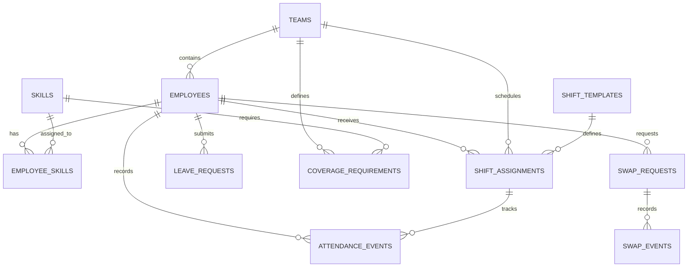

# Database Schema

## 1. Overview

The Workforce Console uses SQLite to store operational workforce data. The database contains 12 operational tables representing teams, employees, skills, shifts, leave, attendance, coverage requirements, and shift swaps.

The database is created from the generated CSV files by `src/create_database.py`. The separate anomaly ground-truth file is excluded from the operational database.

## 2. Entity Relationship Diagram

The following diagram describes the main entities and their relationships.



The diagram illustrates the intended relationships between the operational entities. The database's actual column definitions and foreign-key constraints are established by `src/create_database.py`.

## 3. Table Descriptions

| Table | Purpose |
|---|---|
| `teams` | Stores workforce team records. |
| `employees` | Stores employee records and their team relationships. |
| `skills` | Stores the available workforce skills. |
| `employee_skills` | Associates employees with their skills through a bridge table. |
| `shift_templates` | Defines reusable shift templates. |
| `shift_assignments` | Stores scheduled employee shifts. |
| `leave_requests` | Stores employee leave requests and their statuses. |
| `holiday_calendar` | Stores public holiday calendar entries. |
| `attendance_events` | Records attendance events associated with employees and shifts. |
| `coverage_requirements` | Defines staffing and skill requirements for teams and shifts. |
| `swap_requests` | Stores employee shift-swap requests and their statuses. |
| `swap_events` | Preserves the history of shift-swap lifecycle events. |

## 4. Primary Keys and Foreign Keys

Each operational table has a primary key used to identify its records. The database creation and verification scripts check primary-key uniqueness, non-null values, and foreign-key integrity.

The principal relationships include:

- Employees reference their teams.
- Employee-skill records reference employees and skills.
- Shift assignments reference employees, teams, and shift templates.
- Leave requests reference employees.
- Attendance events reference employees and shift assignments.
- Coverage requirements reference teams and skills.
- Swap history events reference their associated swap requests.

The `employee_skills` table represents a many-to-many relationship between employees and skills. The `swap_events` table supports traceability by preserving events associated with a swap request.

## 5. Data Integrity

The project validates the database using `src/verify_database.py`.

The full-scale database verification completed with:

- 12 operational tables present.
- 257,058 operational records.
- 27 verification checks passed.
- 0 verification checks failed.
- No foreign-key integrity errors.
- Ground-truth anomaly labels excluded from operational tables.

## 6. Ground-Truth Separation

Injected anomaly reference labels are stored separately from operational records. The dashboard calculates its scheduling exceptions from operational data rather than relying on those labels.

This separation supports independent evaluation of the exception-detection logic.

## 7. Recreating the Database

From the project root, activate the virtual environment and generate the data before creating the database.

```powershell
python src/generate_data.py --full --seed 20261022
python src/create_database.py
python src/verify_database.py
```

These commands regenerate the synthetic dataset, build the SQLite database, and verify the resulting database integrity.
